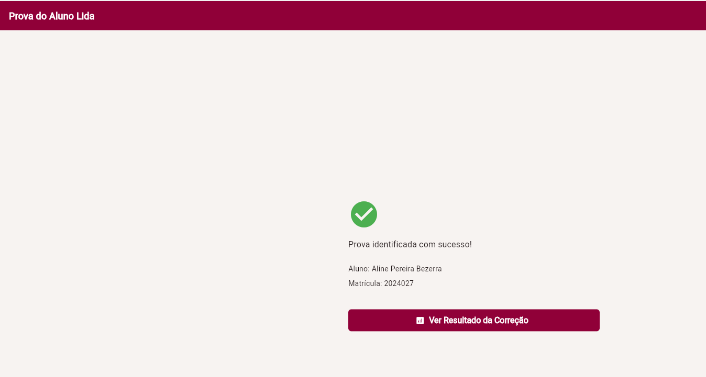
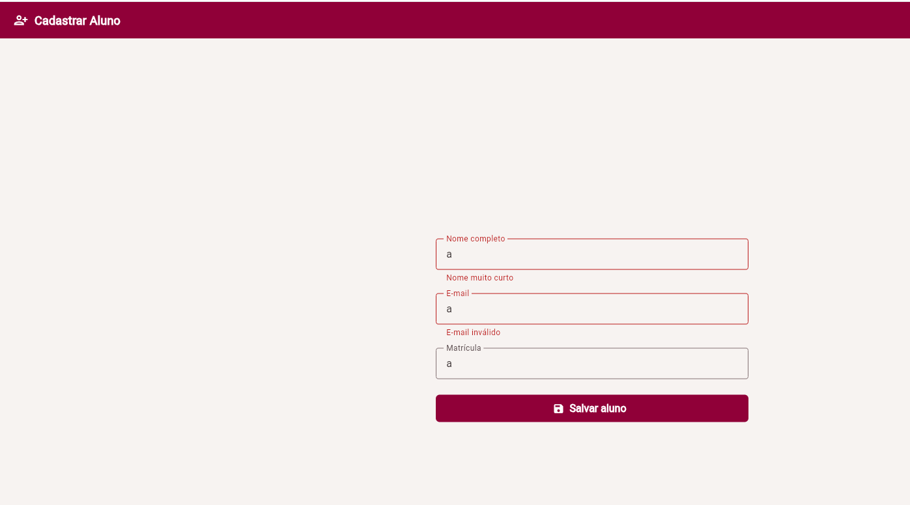
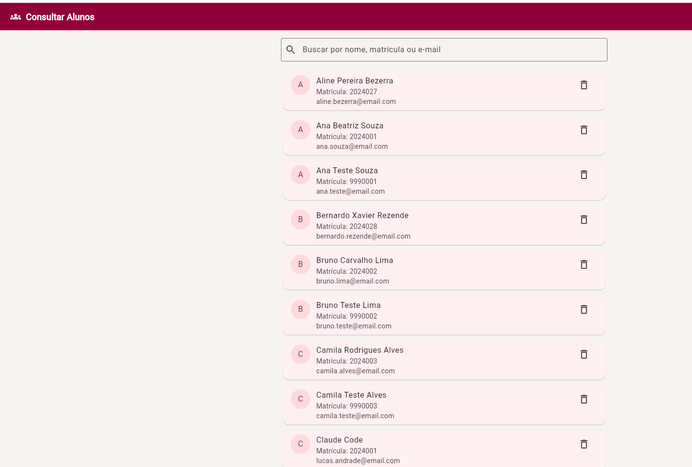
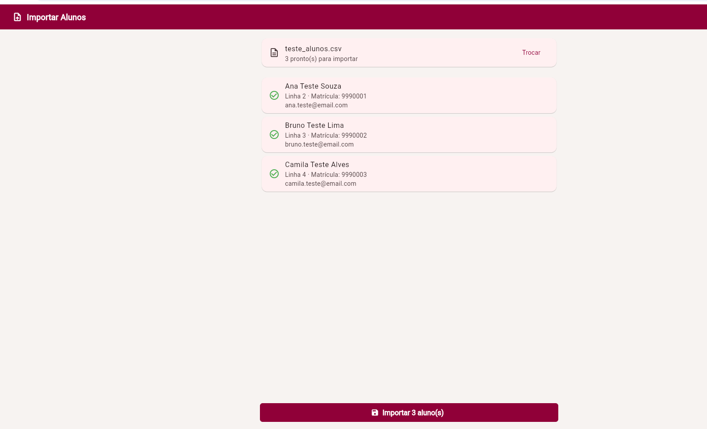
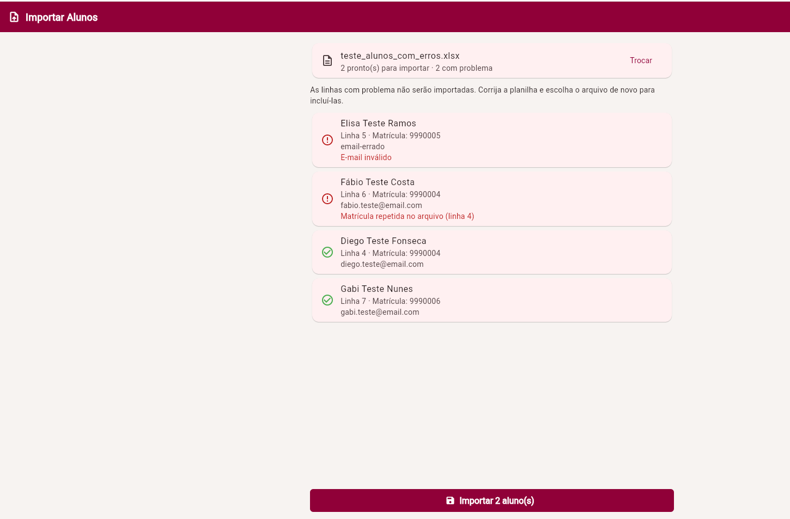

<div align="center">

# 📱 Mobile — Corretor de Provas

**Aplicativo para professores montarem provas objetivas e corrigirem as folhas de resposta automaticamente, com notas e estatísticas salvas na nuvem.**


</div>

## 👥 Equipe

**Codex Ludus**

| Nome completo |
|---|
| Erika Lourrana Silva de Figueiredo |
| Guilherme Ferraz |
| Kauane Mota |
| Lucas Montimór |
| Felipe |

## 📑 Sumário

- [1. Visão Geral](#1-visão-geral)
- [2. Requisitos](#2-requisitos)
  - [2.1 Funcionais (RF)](#21-funcionais-rf)
  - [2.2 Não Funcionais (RNF)](#22-não-funcionais-rnf)
- [3. Telas do Sistema](#3-telas-do-sistema)
- [4. Modelo de Dados](#4-modelo-de-dados)
- [5. Stack Tecnológica](#5-stack-tecnológica)
- [6. Estrutura de Pastas](#6-estrutura-de-pastas)
- [7. Como Executar o Projeto](#7-como-executar-o-projeto)
- [8. Backlog de Atividades da N2](#8-backlog-de-atividades-da-n2)

---

## 1. Visão Geral

📌 **N1**

O cliente é um professor que, na semana de provas, chega a ter de 200 a 400 avaliações objetivas para corrigir à mão. Isso consome um tempo que ele não tem e atrasa a devolução das notas. Além disso, a ferramenta que ele usa hoje informa só se o aluno acertou ou errou, sem mostrar qual alternativa foi marcada, informação que ele precisa para entender os erros da turma.

O **Corretor de Provas** resolve isso para o professor: ele monta a prova a partir de um banco de questões, aplica, recolhe apenas a folha de resposta, e o app identifica o aluno pelo QR Code da folha, lê as marcações e calcula a nota. As notas e a estatística de cada questão ficam salvas no Firebase Firestore.

## 2. Requisitos

📌 **N1** (revisados na N2, com a situação de cada requisito no app atual)

### 2.1 Funcionais (RF)

| Código | Requisito | Situação na N2 |
|---|---|---|
| RF01 | O sistema deve permitir cadastrar, editar e excluir questões em um banco de questões. | ✅ Implementado com Firestore |
| RF02 | O sistema deve permitir montar e gerar uma prova a partir do banco de questões. | ✅ Implementado com Firestore |
| RF03 | O sistema deve embaralhar a ordem das questões e das alternativas entre as provas (variação por aluno). | 🟡 Variações geradas na tela de criar prova; ainda não gravadas por aluno |
| RF04 | O sistema deve gerar a folha de resposta com um QR Code que identifica a prova e o aluno. | 🟡 Conteúdo do QR Code definido (prova + aluno); geração da folha pendente |
| RF05 | O sistema deve ler o gabarito pelo QR Code. | ⏳ Leitura ainda simulada |
| RF06 | O sistema deve ler a folha de resposta do aluno e reconhecer as alternativas marcadas. | 🟡 Aluno escolhido entre os cadastrados no Firestore; leitura pela câmera pendente |
| RF07 | O sistema deve calcular e exibir a nota automaticamente. | 🟡 Cálculo de acertos e nota implementado; tela de resultado ainda com dados simulados |
| RF08 | O sistema deve listar as provas já corrigidas. | ✅ Implementado com Firestore |
| RF09 | O sistema deve gerar a estatística por questão (qual alternativa foi mais assinalada). | ✅ Implementado com Firestore |
| RF10 | O sistema deve gerar o relatório de notas exportável em planilha (Excel). | ⏳ Previsto para a N3 |
| RF11 | O sistema deve permitir importar a lista de alunos. | ✅ Importação de `.xlsx` ou `.csv`, com validação antes de gravar |
| RF12 | O sistema deve gerar a prova individualizada, identificável por aluno pela folha de resposta. | 🟡 Resultado ligado à prova e ao aluno; folha individual pendente |

Além do escopo original, a N2 trouxe cadastro e login de professor, cadastro e consulta de turmas e de alunos.

### 2.2 Não Funcionais (RNF)

| Código | Requisito |
|---|---|
| RNF01 | O sistema deve ser um aplicativo mobile, desenvolvido em Flutter/Dart. |
| RNF02 | A interface deve ser minimalista, com poucos elementos por tela, priorizando ser amigável e fácil de usar. |
| RNF03 | A navegação deve ter um fluxo lógico e claro entre as telas. |
| RNF04 | A correção deve ser rápida: referência de corrigir uma turma de ~50 alunos em cerca de 30 minutos. |
| RNF05 | Os dados de saída devem ser, preferencialmente, em planilha (Excel). |
| RNF06 | Na N1, as telas eram navegáveis com dados fictícios (mock), sem banco de dados. |
| RNF07 | A partir da N2, os dados devem ser armazenados no Firebase Firestore. |
| RNF08 | Limite de escopo: geração da prova em formato editável (`.doc`) e ajuste de layout são sugestões secundárias. |
| RNF09 | Os dados de alunos devem ser validados antes da gravação (nome, e-mail e matrícula sem duplicidade). |
| RNF10 | As telas que leem o banco devem tratar os estados de carregamento, lista vazia e erro de conexão. |

## 3. Telas do Sistema

📌 **N1** (atualizado na N2)

**Correção de prova**


*Corrigir Prova → Ler prova do aluno: o professor escolhe o aluno entre os cadastrados no Firestore e o app mostra a prova identificada.*

**Alunos**


*Cadastrar aluno: formulário com validação de nome, e-mail e matrícula antes de gravar no Firestore.*


*Consultar alunos: lista em tempo real do Firestore, com busca por nome, matrícula ou e-mail, edição e exclusão.*


*Importar alunos: o professor escolhe uma planilha `.xlsx` ou `.csv` e vê uma prévia antes de gravar.*


*Importar alunos: linhas com e-mail inválido ou matrícula repetida aparecem com o motivo e não são gravadas.*

## 4. Modelo de Dados

📌 **N3** (antecipado na N2, a partir das coleções já usadas pelo app)

O Firestore guarda os dados em coleções de documentos. Abaixo, um exemplo de documento de cada coleção e o dicionário de dados.

```json
// Coleção: professores (id do documento = uid do Firebase Auth)
{
  "uid": "Xy12AbC...",
  "nomeCompleto": "Maria Silva",
  "dataNascimento": "10/03/1985",
  "email": "maria@escola.com",
  "fotoUrl": null
}
```

| Campo | Tipo | Descrição |
|---|---|---|
| uid | String | Identificador do professor no Firebase Auth |
| nomeCompleto | String | Nome do professor |
| dataNascimento | String | Data de nascimento |
| email | String | E-mail de login |
| fotoUrl | String (opcional) | Endereço da foto de perfil |

```json
// Coleção: alunos
{
  "nome": "Ana Beatriz Souza",
  "email": "ana.souza@email.com",
  "matricula": "2024001"
}
```

| Campo | Tipo | Descrição |
|---|---|---|
| nome | String | Nome completo do aluno |
| email | String | E-mail do aluno (sempre em minúsculas) |
| matricula | String | Matrícula, única entre os alunos |

```json
// Coleção: turmas
{
  "nome": "Turma A - Direito Matutino",
  "alunos": [
    { "id": "k3Jd...", "nome": "Ana Beatriz Souza", "email": "ana.souza@email.com", "matricula": "2024001" }
  ]
}
```

| Campo | Tipo | Descrição |
|---|---|---|
| nome | String | Nome da turma, único |
| alunos | Array de mapas | Alunos vinculados (id, nome, e-mail e matrícula) |

```json
// Coleção: questoes
{
  "enunciado": "Qual é a capital do Brasil?",
  "materiaId": "1",
  "alternativas": [
    { "texto": "São Paulo", "isCorreta": false },
    { "texto": "Brasília", "isCorreta": true }
  ]
}
```

| Campo | Tipo | Descrição |
|---|---|---|
| enunciado | String | Texto da questão |
| materiaId | String (opcional) | Matéria à qual a questão pertence |
| alternativas | Array de mapas | Texto de cada alternativa e se ela é a correta |

```json
// Coleção: provas
{
  "titulo": "Prova 1 - Direito Constitucional",
  "questaoIds": ["q1Ab...", "q7Cd..."],
  "criadoEm": "2026-10-20T14:30:00Z"
}
```

| Campo | Tipo | Descrição |
|---|---|---|
| titulo | String | Título da prova |
| questaoIds | Array de String | Ids das questões, na ordem da prova |
| criadoEm | Timestamp | Data de criação (horário do servidor) |

```json
// Coleção: resultados (id do documento = "<provaId>_<alunoId>")
{
  "provaId": "p9Xy...",
  "alunoId": "k3Jd...",
  "alunoNome": "Ana Beatriz Souza",
  "alunoMatricula": "2024001",
  "respostas": { "q1Ab...": 1, "q7Cd...": null },
  "acertos": 1,
  "totalQuestoes": 2,
  "nota": 5.0,
  "corrigidoEm": "2026-10-22T10:05:00Z"
}
```

| Campo | Tipo | Descrição |
|---|---|---|
| provaId | String | Prova corrigida |
| alunoId | String | Aluno dono da folha |
| alunoNome / alunoMatricula | String | Cópia dos dados do aluno no momento da correção, para os relatórios |
| respostas | Mapa | Id da questão → índice da alternativa marcada na questão original (`null` = em branco ou inválida) |
| acertos | Número | Quantidade de questões certas |
| totalQuestoes | Número | Quantidade de questões da prova |
| nota | Número | Nota de 0 a 10 |
| corrigidoEm | Timestamp | Data da correção (horário do servidor) |

O id do resultado é formado pela prova e pelo aluno, para que corrigir a mesma folha de novo substitua o resultado em vez de duplicá-lo. O QR Code da folha de resposta usa o formato `CORRETOR|1|<provaId>|<alunoId>`.

## 5. Stack Tecnológica

📌 **N1** (ampliada na N2)


- **Flutter**: framework usado para construir a interface e a navegação do app mobile.
- **Dart**: linguagem de programação usada no Flutter.
- **Firebase Firestore** (`cloud_firestore`): banco de dados em nuvem (NoSQL) que guarda professores, alunos, turmas, questões, provas e resultados.
- **Firebase Auth** (`firebase_auth`): cadastro e login do professor por e-mail e senha.
- **Firebase Core** (`firebase_core`): inicializa a conexão do app com o projeto Firebase.
- **file_picker**: abre o seletor de arquivos para escolher a planilha de alunos.
- **excel** e **csv**: leem as planilhas `.xlsx` e `.csv` na importação de alunos.
- **flutter_test**: testes automatizados da importação de alunos e do cálculo da nota.

## 6. Estrutura de Pastas

📌 **N1**, atualizada na N2

```
lib/
  main.dart             # ponto de entrada: inicializa o Firebase, aplica o tema e abre o login
  firebase_options.dart # configuração de conexão com o projeto Firebase (gerada pelo FlutterFire)
  models/               # entidades do app (Aluno, Turma, Questao, Alternativa, Prova, Resultado, Professor...)
  screens/              # telas do aplicativo
  services/             # comunicação com o Firebase (um serviço por coleção) e importação de alunos
  utils/                # funções de apoio (formatadores e validação dos dados do aluno)
  theme/                # cores e tema visual do app
  widgets/              # componentes de interface reutilizáveis entre telas
  mocks/                # dados fictícios da N1 que ainda apoiam telas não migradas
test/                   # testes automatizados
docs/
  telas/                # prints das telas usadas neste README
  modelo_importacao_alunos.csv  # exemplo de planilha para importar alunos
```

## 7. Como Executar o Projeto

📌 **N1**, revisado na N2

Pré-requisitos: [Flutter SDK](https://docs.flutter.dev/get-started/install) instalado e um emulador, celular Android ou o navegador Chrome.

```
1. git clone https://github.com/guiferrazk/Mobile-.git
2. cd Mobile-
3. flutter pub get
4. flutter run              (ou: flutter run -d chrome)
```

A conexão com o Firebase já está configurada no repositório (`lib/firebase_options.dart` e `android/app/google-services.json`), então não é preciso nenhum passo extra. Na primeira execução, crie uma conta de professor em **"Não tem uma conta? Cadastre-se"** na tela de login.

Para rodar os testes automatizados:

```
flutter test test/importacao_alunos_test.dart test/identificacao_resultado_test.dart
```

## 8. Backlog de Atividades da N2

📌 **N2**

Backlog real da N2, conferido com os Pull Requests mesclados no repositório.

### Erika Lourrana Silva de Figueiredo

| Tarefa | Prazo | Status |
|---|---|---|
| Implementar persistência das provas corrigidas (PR #25) | 11/10 | Concluído |
| Ajustar tela de Relatórios de Provas Corrigidas, com estados de carregamento, vazio e erro (PR #25) | 16/10 | Concluído |
| Implementar estatísticas por questão (PR #26) | 20/10 | Concluído |
| Atualizar diário de bordo individual | 25/10 | Concluído |

### Guilherme Ferraz

| Tarefa | Prazo | Status |
|---|---|---|
| Implementar persistência de alunos: substituir o último uso do mock de alunos, na tela de correção (PR #22) | 09/10 | Concluído |
| Implementar importação da lista de alunos (`.xlsx`/`.csv`) com validação antes da gravação (PR #23) | 14/10 | Concluído |
| Integrar fluxo de identificação prova/aluno/resultado (PR #24) | 18/10 | Concluído |
| Revisar e aprovar as PRs #25 e #26 | 29/10 | Concluído |
| Atualizar diário de bordo individual | 25/10 | Concluído |

### Kauane Mota

| Tarefa | Prazo | Status |
|---|---|---|
| Modelar classes de domínio e estruturas do Firestore (PR #21) | 06/10 | Concluído |
| Implementar persistência das provas (PR #21) | 10/10 | Concluído |
| Implementar geração/registro de prova com dados reais (PR #21) | 15/10 | Concluído |
| Atualizar diário de bordo individual | 25/10 | Concluído |

### Lucas Montimór

| Tarefa | Prazo | Status |
|---|---|---|
| Configurar Firebase/Firestore no projeto (PR #17) | 05/10 | Concluído |
| Implementar persistência do Banco de Questões (PR #18) | 08/10 | Concluído |
| Implementar cadastro/edição de questões (PR #18) | 12/10 | Concluído |
| Cadastro e consulta de turmas e de alunos no Firestore (PR #19) | — | Concluído |
| Tela de login, cadastro e perfil do professor (PR #20) | — | Concluído |
| Atualizar diário de bordo individual | 25/10 | Concluído |

### Felipe

| Tarefa | Prazo | Status |
|---|---|---|
| Revisar navegação e integração entre telas | 13/10 | Pendente |
| Revisar estados de carregamento, erro e dados vazios | 17/10 | Pendente |
| Gerar e validar APK com banco funcional | 23/10 | Pendente |
| Atualizar diário de bordo individual | 25/10 | Pendente |

---

<div align="center">

*README elaborado para a disciplina de Desenvolvimento de Dispositivos Móveis*

</div>
